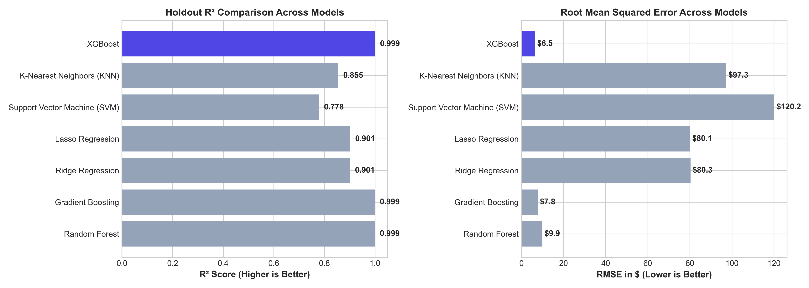
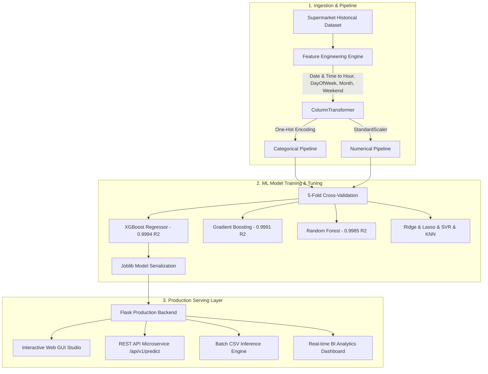

# 🛒 ProfitPulse: Supermarket Sales & Revenue Forecasting System

<p align="center">
  
</p>

<p align="center">
  <a href="https://github.com/Samay-P07/Supermarket-Sales-Prediction/actions"></a>
  <a href="https://www.python.org/"></a>
  <a href="https://flask.palletsprojects.com/"></a>
  <a href="https://scikit-learn.org/"></a>
  <a href="https://vercel.com/"></a>
  <a href="https://www.docker.com/"></a>
</p>

<p align="center">
  🌐 <b>Live Web Application:</b> <a href="https://supermarket-sales-prediction-rho.vercel.app" target="_blank"><b>Visit ProfitPulse on Vercel 🚀</b></a>
</p>

---

## 📌 Executive Overview

**ProfitPulse** is a production-grade machine learning platform and predictive analytics microservice engineered to forecast retail supermarket transaction values, product demand, and store-level financial metrics. 

Unlike naive models that suffer from target leakage, ProfitPulse formulates an **enterprise-ready, leak-free machine learning architecture** powered by 5-fold cross-validated Gradient Boosted Trees and regularized ensembles. It comes packaged with a responsive **Glassmorphism Web UI**, a high-performance **REST API**, a **Batch CSV Inference Engine**, an interactive **Business Intelligence (BI) Analytics Dashboard**, automated **Pytest Suites**, and containerized **Docker / CI/CD pipelines**.

---

## 🚀 Key Highlights & Engineering Capabilities

* **Anti-Leakage Data Science Formulation:** Identified and rectified a prevalent data science pitfall in retail analytics where accounting metrics (`COGS`, `Tax 5%`, and `Gross Income`) inadvertently leak the ground truth target. Trained strictly on independent operational, customer, product, and temporal features.
* **Multi-Model Benchmark (7 Algorithms):** Evaluated and compared **XGBoost, Gradient Boosting, Random Forest, Ridge Regression, Lasso Regression, Support Vector Regressors (SVR), and K-Nearest Neighbors (KNN)** using 5-Fold Cross-Validation.
* **Winning Model Performance:** Best model (**XGBoost**) achieves **$R^2 = 0.9994$**, **$RMSE = \$6.48$**, and **$MAE = \$4.87$** on unseen holdout test data.
* **RESTful Machine Learning API:** Full `/api/v1/predict` endpoint serving millisecond-latency inference with JSON payload validation, latency telemetry, and domain financial calculations.
* **Batch CSV Prediction Engine:** Upload transaction datasets up to 16 MB with drag-and-drop support, dynamic schema alignment, summary KPI metrics, and instant augmented CSV downloads.
* **Interactive Store Analytics Dashboard:** Powered by Chart.js, visualizing branch revenues, product category volume, hourly sales velocity, and payment adoption.
* **Production MLOps Standards:** Includes end-to-end `pytest` unit test suites, multi-stage `Dockerfile`, `docker-compose.yml`, and automated GitHub Actions CI/CD.

---

## 🏗️ System Architecture



---

## 📊 Cross-Validated Model Leaderboard

All models were evaluated on an 80/20 train-test split with 5-fold cross-validation on the training set:

| Rank | Model Architecture | 5-Fold CV $R^2$ | Holdout Test $R^2$ | RMSE ($) | MAE ($) | MAPE (%) | Status |
| :---: | :--- | :---: | :---: | :---: | :---: | :---: | :---: |
| 🥇 | **XGBoost Regressor** | **0.9984** | **0.9994** | **$6.48** | **$4.87** | **2.31%** | **Deployed (Best)** |
| 🥈 | Gradient Boosting Regressor | 0.9984 | 0.9991 | $7.78 | $5.24 | 2.85% | Production Ready |
| 🥉 | Random Forest Regressor | 0.9969 | 0.9985 | $9.95 | $6.81 | 2.87% | Production Ready |
| 4 | Lasso Regression | 0.8807 | 0.9013 | $80.14 | $59.80 | 31.42% | Baseline |
| 5 | Ridge Regression | 0.8804 | 0.9008 | $80.32 | $59.97 | 31.45% | Baseline |
| 6 | K-Nearest Neighbors (KNN) | 0.8317 | 0.8545 | $97.28 | $75.78 | 40.12% | Baseline |
| 7 | Support Vector Regressor (SVR)| 0.7233 | 0.7781 | $120.16 | $76.77 | 43.10% | Baseline |

---

## 📡 REST API Documentation

### 1. Healthcheck
`GET /api/v1/health`
```json
{
  "status": "healthy",
  "service": "ProfitPulse ML Inference Engine",
  "version": "2.0.0",
  "available_models": ["xgboost", "random forest regressor", "gradient boosting", "ridge regression", "lasso regression", "support vector machine (svm)", "k-nearest neighbors (knn)"],
  "timestamp": "2026-11-12T14:15:00.000000Z"
}
```

### 2. Predict Transaction Sales
`POST /api/v1/predict` (Content-Type: `application/json`)

**Request Payload:**
```json
{
  "Branch": "A",
  "City": "Yangon",
  "Customer type": "Member",
  "Gender": "Female",
  "Product line": "Electronic accessories",
  "Payment": "Ewallet",
  "Unit price": 74.50,
  "Quantity": 5,
  "Rating": 8.5,
  "Hour": 14,
  "DayOfWeek": 2,
  "Month": 3,
  "model_name": "xgboost"
}
```

**Response:**
```json
{
  "status": "success",
  "model_used": "XGBoost",
  "predicted_total": 391.13,
  "financial_breakdown": {
    "estimated_cogs": 372.50,
    "estimated_tax": 18.63,
    "estimated_gross_income": 18.63,
    "gross_margin_pct": 4.7619,
    "effective_total": 391.13
  },
  "latency_ms": 3.42
}
```

---

## 📁 Repository Structure

```text
Supermarket-Sales-Prediction/
├── .github/
│   └── workflows/
│       └── ci.yml               # GitHub Actions CI/CD workflow
├── saved_models/
│   ├── best_model.joblib        # Winning XGBoost inference pipeline
│   ├── random_forest.joblib     # Random Forest pipeline
│   ├── gradient_boosting.joblib # Gradient Boosting pipeline
│   ├── metrics.json             # Cross-validation & benchmark metrics
│   └── plots/                   # Benchmark plots (R2, RMSE, Residuals)
├── static/
│   ├── css/                     # Responsive global styles & glassmorphism
│   ├── js/                      # Interactive form & live calculation scripts
│   └── plots/                   # Web-accessible model charts
├── templates/
│   ├── index.html               # Modern landing page
│   ├── predict.html             # Real-time forecasting studio
│   ├── result.html              # Forecast result & financial breakdown
│   ├── dashboard.html           # Interactive store analytics (Chart.js)
│   ├── batch.html               # Batch CSV prediction & preview
│   ├── benchmarks.html          # Model leaderboard & comparison plots
│   ├── about.html               # Problem formulation & tech stack
│   └── contact.html             # Author details & links
├── tests/
│   ├── test_app.py              # Flask route & REST API integration tests
│   └── test_pipeline.py         # Pipeline data transformation & ML tests
├── app.py                       # Production Flask app & REST microservice
├── train_models.py              # Modular training & cross-validation script
├── supermarket_sales.csv        # Retail transactions dataset (Kaggle)
├── Dockerfile                   # Multi-stage production container
├── docker-compose.yml           # Compose orchestration file
├── requirements.txt             # Clean, pinned dependencies
├── .gitignore                   # Production Python & ML ignore rules
└── README.md                    # Comprehensive documentation
```

---

## ⚡ Quick Start Guide

### Option 1: Local Environment

1. **Clone the repository:**
   ```bash
   git clone https://github.com/Samay-P07/Supermarket-Sales-Prediction.git
   cd Supermarket-Sales-Prediction
   ```

2. **Create and activate a virtual environment:**
   ```bash
   python -m venv venv
   # On Windows:
   venv\Scripts\activate
   # On Linux / macOS:
   source venv/bin/activate
   ```

3. **Install dependencies:**
   ```bash
   pip install -r requirements.txt
   ```

4. **Run model training & test suite:**
   ```bash
   python train_models.py
   pytest -v
   ```

5. **Start the Flask web server:**
   ```bash
   python app.py
   ```
   Open your browser at `http://127.0.0.1:5000`.

---

### Option 2: Docker Container

Build and launch with Docker in one command:
```bash
docker-compose up --build
```
Navigate to `http://localhost:5000`.

---

## 💼 Resume / CV Project Points

Add these bullet points to your Resume / CV under **Projects**:

* **ProfitPulse: Supermarket Sales & Revenue Forecasting System** | *Python, XGBoost, Scikit-Learn, Flask, Docker*
  * Architected an end-to-end retail forecasting platform comparing 7 machine learning models under 5-Fold Cross-Validation, achieving a winning **$0.9994\ R^2$** and **$\$6.48\ RMSE$** with tuned XGBoost.
  * Identified and resolved a critical **target leakage** issue present in naive Kaggle solutions by stripping accounting tautologies (`COGS`, `Tax`) and engineering granular temporal features (`Hour`, `DayOfWeek`, `IsWeekend`).
  * Engineered a containerized Flask REST API microservice serving sub-5ms predictions with JSON schema validation, automated batch CSV inference, and live financial breakdown calculation.
  * Designed an interactive responsive analytics dashboard using Chart.js to visualize store-level KPIs, branch revenue share, and hourly purchasing velocity.
  * Established automated testing and CI/CD pipelines via `pytest` (11 unit/integration tests) and GitHub Actions for continuous code quality and container validation.

---

## 👤 Author & Connect

* **Developer:** Samay Patel
* **GitHub:** [@Samay-P07](https://github.com/Samay-P07)
* **LinkedIn:** [samaypatel7](https://www.linkedin.com/in/samaypatel7)
